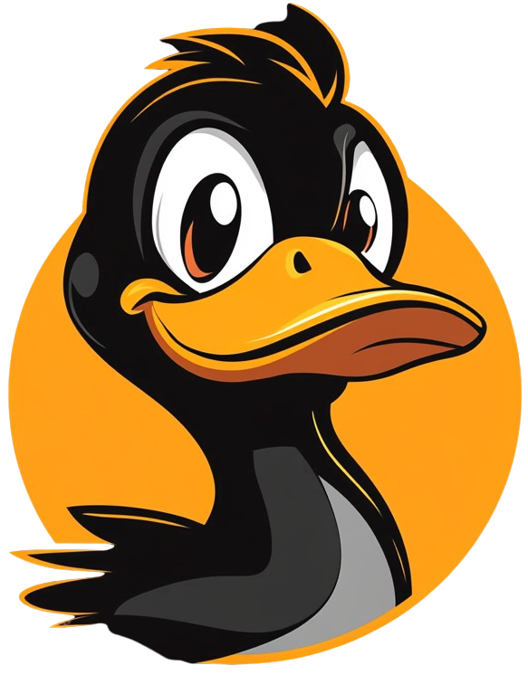
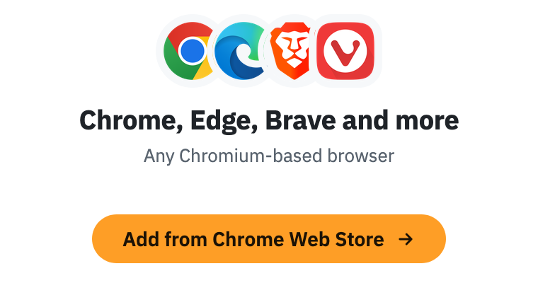
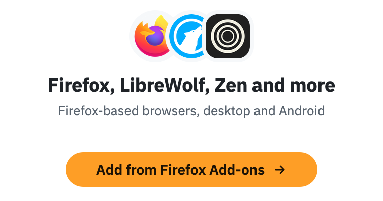
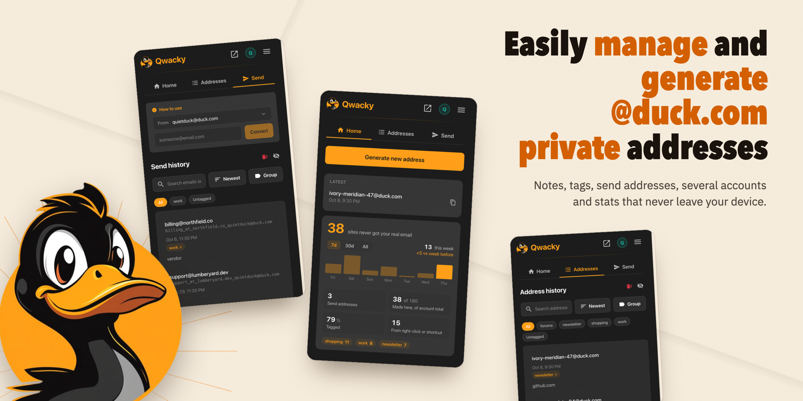

<p align="center">
  
</p>

<h1 align="center">Qwacky</h1>

<p align="center">A home for your DuckDuckGo <b>@duck.com</b> addresses. Generate, organise and send from them, right in your browser.</p>

<table align="center">
  <tr>
    <td align="center" width="50%">
      <a href="https://chromewebstore.google.com/detail/qwacky/kieehbhdbincplacegpjdkoglfakboeo"><picture>
        <source media="(prefers-color-scheme: dark)" srcset="assets/images/stores/chromium-dark.png">
        
      </picture></a>
      <br>
      <a href="https://chromewebstore.google.com/detail/qwacky/kieehbhdbincplacegpjdkoglfakboeo"></a>
      <a href="https://chromewebstore.google.com/detail/qwacky/kieehbhdbincplacegpjdkoglfakboeo"></a>
      <a href="https://chromewebstore.google.com/detail/qwacky/kieehbhdbincplacegpjdkoglfakboeo"></a>
    </td>
    <td align="center" width="50%">
      <a href="https://addons.mozilla.org/en-US/firefox/addon/qwacky/"><picture>
        <source media="(prefers-color-scheme: dark)" srcset="assets/images/stores/firefox-dark.png">
        
      </picture></a>
      <br>
      <a href="https://addons.mozilla.org/en-US/firefox/addon/qwacky/"></a>
      <a href="https://addons.mozilla.org/en-US/firefox/addon/qwacky/"></a>
      <a href="https://addons.mozilla.org/en-US/firefox/addon/qwacky/"></a>
    </td>
  </tr>
</table>

<p align="center">
<a href="#-why-qwacky">Why Qwacky?</a>&nbsp;&nbsp;&bull;&nbsp;&nbsp;<a href="#-features">Features</a>&nbsp;&nbsp;&bull;&nbsp;&nbsp;<a href="#-privacy">Privacy</a>&nbsp;&nbsp;&bull;&nbsp;&nbsp;<a href="#-install-manually">Install manually</a>&nbsp;&nbsp;&bull;&nbsp;&nbsp;<a href="#-development">Development</a>&nbsp;&nbsp;&bull;&nbsp;&nbsp;<a href="#-support-the-project">Support the Project</a>
</p>

<p align="center">
  
</p>

# 🦆 Why Qwacky?

[DuckDuckGo Email Protection](https://duckduckgo.com/email) gives you private @duck.com addresses that forward to your real inbox with email trackers removed. Qwacky is a dedicated home for those addresses.

The DuckDuckGo extension treats an alias as something you generate and forget. Qwacky treats it as something you manage: a searchable history with notes and tags, send addresses with their own history, several Duck accounts side by side, autofill from the right-click menu or a keyboard shortcut, light and dark themes, backups and sync, and usage statistics computed on your device. It asks for one host permission, runs no analytics, and does nothing else.

# ✨ Features
- **Private @duck.com addresses:** generate a fresh alias from the popup, the right-click menu or a keyboard shortcut
- **A home for every alias:** searchable history with notes, tags, grouping and filtering
- **Send privately:** turn any recipient into a send address so your real one stays hidden
- **Multiple accounts:** manage and switch between colour-coded Duck accounts in one place
- **Your numbers, on your device:** usage statistics with nothing sent anywhere
- **Your data, portable:** cross-device sync, plus backup and restore
- **Your call:** privacy mode that stores nothing, compact mode, light and dark themes
- **And more on the way**

# 🔒 Privacy
<a name="browser-specific-permission-handling-and-limitations"></a>

- Talks only to DuckDuckGo, and to your browser's sync if you turn it on
- Everything is stored on your device, with no servers, analytics or tracking
- Autofill permissions are optional and off until you enable them
- Open source, so every claim here can be checked

Read the full [privacy policy](PRIVACY.md) for what is stored and why each permission is needed.

# 📦 Install manually

Every [release](https://github.com/Lanshuns/Qwacky/releases) on GitHub includes both builds, if you'd rather not use a store or need a specific version.

**Chrome, Edge, Brave and other Chromium browsers**
1. Download `chrome-vX.Y.Z.zip` from the release and unzip it
2. Open your extensions page (`chrome://extensions`, or `edge://extensions` in Edge) and turn on **Developer mode**
3. Click **Load unpacked** and pick the unzipped folder

A build loaded this way doesn't update itself, so check Releases for new versions.

**Firefox**
1. Download `firefox-vX.Y.Z.xpi` from the release, it's signed by Mozilla
2. Open `about:addons`, click the gear icon and choose **Install Add-on From File...**
3. Pick the downloaded file

# 💻 Development

Requires Node.js 16 or newer.

```bash
git clone https://github.com/Lanshuns/Qwacky.git
cd Qwacky
npm install
npm run dev            # Chrome, watches into dist_chrome/
npm run dev:firefox    # Firefox, watches into dist_firefox/
npm run build          # production build (build:firefox for Firefox)
```

Load `dist_chrome/` with "Load unpacked" in `chrome://extensions/`, or load `dist_firefox/manifest.json` from `about:debugging` > This Firefox > "Load Temporary Add-on".

# 💖 Support the Project

- **Star the repository** on GitHub, it helps others discover the project
- **Leave a review** on the [Chrome Web Store](https://chromewebstore.google.com/detail/qwacky/kieehbhdbincplacegpjdkoglfakboeo/reviews) or [Firefox Add-ons](https://addons.mozilla.org/en-US/firefox/addon/qwacky/reviews/), it makes a big difference
- **Donate via cryptocurrency:**

| Currency | Address |
|----------|---------|
| **Bitcoin (BTC)** | `bc1qmmwwsn4cvpsx39sf53qsqcjyjzsqp90lus365w` |
| **Ethereum (ETH)** | `0x08658772EeC32e72456048Be5D5a52bd3bcb01bc` |
| **Litecoin (LTC)** | `LKYDeJWeo3kMG1TbY4cqSi87wFeR6YUXP2` |
| **USDT (TRON/TRX)** | `TAhdRW3nJxinWjrdYfSWB31RdjRkQKvkEq` |
| **USDT (BEP-20)** | `0x08658772EeC32e72456048Be5D5a52bd3bcb01bc` |

> If you'd like to be recognized for your donation, feel free to [open an issue](https://github.com/Lanshuns/Qwacky/issues/new) with your name and transaction ID, and I'll add you to the supporters list!

# 🙏 Acknowledgments

This project is a derivative work based on DuckDuckGo's Email Protection service, which is licensed under the Apache License 2.0. The original work's copyright notice:

Copyright (c) 2010-2021 Duck Duck Go, Inc.

For the full license text, see [APACHE-LICENSE](https://github.com/duckduckgo/duckduckgo-privacy-extension/blob/main/LICENSE.md).
